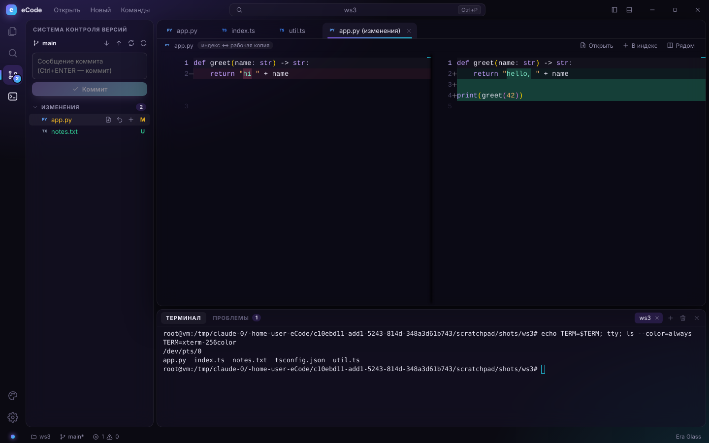

# eCode

**For humans and comfort.** Быстрый и красивый редактор кода в стиле eraAI: Electron + React + Monaco (то же ядро редактора, что и в VS Code).



## Возможности

- **Редактор Monaco**: подсветка 80+ языков, мультикурсоры, sticky scroll, мини-карта, цветные пары скобок.
- **Языковые серверы (LSP)** для **Python** (Pyright) и **TypeScript/JavaScript** (typescript-language-server). Работают без установки: серверы идут в комплекте и запускаются на встроенном Node из Electron.
  - Автодополнение с документацией, подсказки при наведении, сигнатуры функций.
  - Переход к определению (F12), в том числе в другой файл.
  - Переименование символа во всём проекте (F2): затронутые файлы открываются во вкладках, их остаётся сохранить.
  - Форматирование, структура файла (Ctrl/⌘+Shift+O).
  - Ошибки и предупреждения прямо в коде и на панели **«Проблемы»** (Ctrl/⌘+Shift+M), счётчики в статус-баре.
- **Git** (Ctrl+Shift+G):
  - изменения и индекс, индексация и откат отдельных файлов или всех сразу;
  - коммит по Ctrl+Enter, push, pull, fetch, синхронизация ↑↓;
  - смена и создание веток, инициализация репозитория;
  - **вкладки с диффами** (рядом или в одну колонку);
  - цвета статусов (M/U/A/D) в проводнике, счётчик изменений на иконке.
- **Настоящий терминал**: xterm.js + node-pty, 256 цветов, `vim`, `htop`, интерактивные программы. Несколько вкладок (Ctrl+Shift+\`), ссылки кликабельны, копирование и вставка по Ctrl+Shift+C/V. Пока фокус в терминале, сочетания вроде Ctrl+R, Ctrl+W, Ctrl+B уходят в оболочку, а палитра и быстрое открытие работают как обычно. Если node-pty не загрузится, включается упрощённый режим.
- **Запуск файла** (Ctrl+F5): Python, Node, TS (через tsx), shell, Ruby, Go — в терминале.
- **Проводник**: виртуализированное дерево, создание файлов и папок прямо в дереве (`src/utils/new.ts` создаст промежуточные папки), F2, корзина, контекстное меню, клавиатура.
- **Вкладки**: перетаскивание, закрытие средней кнопкой, индикатор несохранённых изменений.
- **Быстрое открытие (Ctrl/⌘+P)** с нечётким поиском, **палитра команд (Ctrl/⌘+Shift+P)**, переход к строке (`:42`).
- **Поиск по проекту (Ctrl/⌘+Shift+F)**: регистр, слово целиком, регулярные выражения, фильтр файлов.
- Слежение за файлами на диске, восстановление сессии, drag & drop, своя строка заголовка.

## Три варианта оформления

Переключаются на лету через палитру («Сменить тему»), статус-бар или настройки.

| Era Glass | Graphite | Aurora Light |
| --- | --- | --- |
|  |  |  |
| Тёмное стекло, фиолетово-бирюзовое свечение. Фирменный стиль eraAI. | Матовый графит без размытия, янтарные акценты. Самый быстрый на слабом железе. | Светлое матовое стекло с мягким сиянием. Для дневной работы. |

Тема описывается одним объектом в `src/renderer/src/themes.ts` (CSS-переменные интерфейса и цвета Monaco), поэтому новая добавляется за несколько минут.

## Запуск

```bash
pnpm install
pnpm dev            # режим разработки с HMR
pnpm build          # production-сборка в out/
pnpm start          # запуск собранной версии
pnpm typecheck
pnpm package:win    # или package:mac / package:linux, установщики появятся в dist/
```

## Горячие клавиши

| Действие | Клавиши |
| --- | --- |
| Перейти к файлу | Ctrl/⌘+P |
| Палитра команд | Ctrl/⌘+Shift+P, F1 |
| Перейти к строке | Ctrl+G |
| Поиск по файлам | Ctrl/⌘+Shift+F |
| Проводник | Ctrl/⌘+Shift+E |
| Git | Ctrl+Shift+G |
| Панель (терминал) | Ctrl/⌘+J, Ctrl+` |
| Новый терминал | Ctrl+Shift+` |
| Проблемы | Ctrl/⌘+Shift+M |
| Запустить файл | Ctrl+F5 |
| Перейти к определению / переименовать | F12 / F2 |
| Коммит (в поле сообщения) | Ctrl/⌘+Enter |
| Боковая панель | Ctrl/⌘+B |
| Сохранить / как… / все | Ctrl/⌘+S / +Shift+S / +Alt+S |
| Новый файл / открыть папку | Ctrl/⌘+N / Ctrl/⌘+O |
| Недавние папки | Ctrl/⌘+R |
| Закрыть вкладку | Ctrl/⌘+W |
| Следующая/предыдущая вкладка | Ctrl+Tab / Ctrl+Shift+Tab |
| Символы в файле | Ctrl/⌘+Shift+O |
| Масштаб шрифта | Ctrl/⌘+= / − / 0 |
| Настройки | Ctrl/⌘+, |

## Архитектура

```
src/
  main/           процесс Electron
    index.ts        окно, диалоги, меню
    fs.ts           файловая система, поиск, watcher
    terminal.ts     node-pty (или упрощённая оболочка)
    lsp.ts          запуск языковых серверов, JSON-RPC по stdio
    git.ts          git CLI: статус, индекс, коммит, ветки, push/pull
    settings.ts     настройки
  preload/        безопасный мост window.ecode (contextIsolation + sandbox)
  shared/         общие типы и API
  renderer/src/
    actions.ts        логика (открытие, сохранение, вкладки, файловые операции)
    editorService.ts  модели Monaco, редактор диффов, dirty-трекинг
    lspClient.ts      LSP ↔ Monaco: провайдеры, синхронизация документов, диагностика
    scm.ts            git-действия и диффы
    terminalService.ts сессии xterm.js
    commands.ts       реестр команд и горячих клавиш
    themes.ts         варианты оформления (UI, Monaco, терминал)
    components/       TitleBar, ActivityBar, Explorer, Search, Scm, Settings, EditorArea, Panel, Palette
```

Тяжёлая работа (обход файлов, поиск, git, языковые серверы, PTY) выполняется в main-процессе, интерфейс получает готовые результаты по IPC.

Чтобы проверить упрощённый режим терминала, запустите приложение с `ECODE_NO_PTY=1`.
