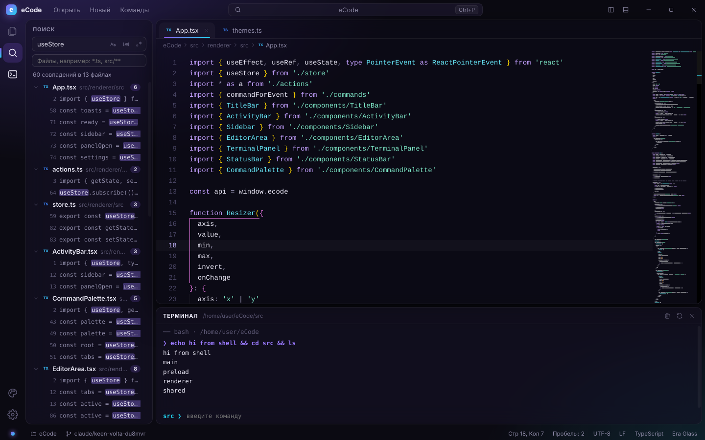
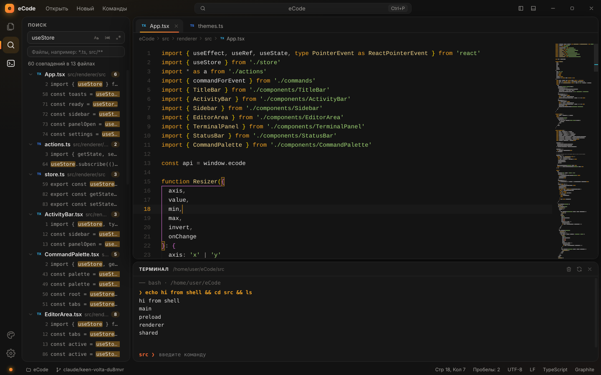
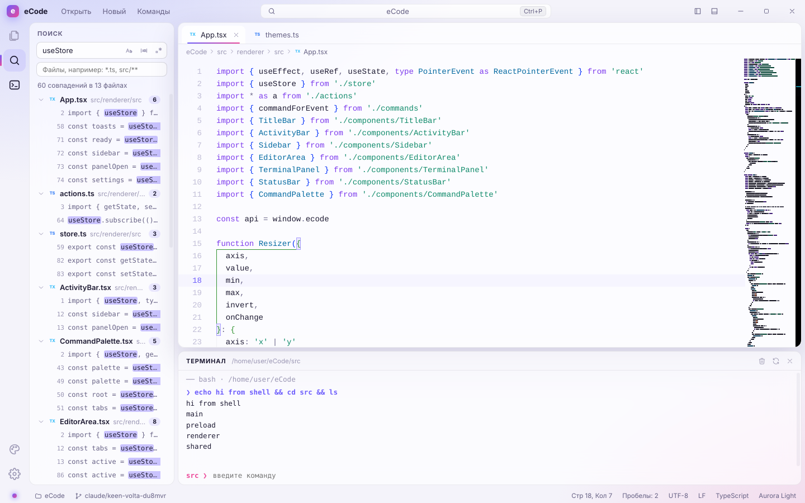

# eCode

**For humans and comfort.** Быстрый и красивый редактор кода в стиле eraAI: Electron + React + Monaco (то же ядро редактора, что и в VS Code).



## Возможности

- **Редактор Monaco**: подсветка 80+ языков, IntelliSense для TS/JS/JSON/CSS/HTML, мультикурсоры, sticky scroll, мини-карта, цветные пары скобок, форматирование.
- **Проводник**: виртуализированное дерево (не тормозит на больших проектах), создание файлов и папок прямо в дереве (`src/utils/new.ts` создаст все промежуточные папки), переименование (F2), удаление в корзину, контекстное меню, навигация с клавиатуры.
- **Вкладки**: перетаскивание, закрытие средней кнопкой мыши, индикатор несохранённых изменений, подтверждение при закрытии.
- **Быстрое открытие (Ctrl/⌘+P)** с нечётким поиском, **палитра команд (Ctrl/⌘+Shift+P)**, переход к строке (`:42`).
- **Поиск по проекту (Ctrl/⌘+Shift+F)**: регистр, слово целиком, регулярные выражения, фильтр файлов (`*.ts, src/**`).
- **Встроенный терминал (Ctrl/⌘+J)**: запоминает текущую папку после `cd`, есть история команд и прерывание по Ctrl+C.
- **Слежение за файлами**: изменения на диске подхватываются автоматически, история отмены сохраняется.
- **Восстановление сессии**: последняя папка и открытые вкладки.
- Ветка git в статус-баре, drag & drop файлов и папок в окно, своя строка заголовка.

## Три варианта оформления

Переключаются на лету через палитру («Сменить тему»), статус-бар или настройки.

| Era Glass | Graphite | Aurora Light |
| --- | --- | --- |
|  |  |  |
| Тёмное стекло, фиолетово-бирюзовое свечение. Фирменный стиль eraAI. | Матовый графит без размытия, янтарные акценты. Самый быстрый на слабом железе. | Светлое матовое стекло с мягким сиянием. Для дневной работы. |

Тема описывается одним объектом в `src/renderer/src/themes.ts` (CSS-переменные интерфейса и цвета Monaco), поэтому новая добавляется за несколько минут.

## Запуск

```bash
pnpm install
pnpm dev            # режим разработки с HMR
pnpm build          # production-сборка в out/
pnpm start          # запуск собранной версии
pnpm typecheck
pnpm package:win    # или package:mac / package:linux, установщики появятся в dist/
```

## Горячие клавиши

| Действие | Клавиши |
| --- | --- |
| Перейти к файлу | Ctrl/⌘+P |
| Палитра команд | Ctrl/⌘+Shift+P, F1 |
| Перейти к строке | Ctrl+G |
| Поиск по файлам | Ctrl/⌘+Shift+F |
| Проводник | Ctrl/⌘+Shift+E |
| Терминал | Ctrl/⌘+J, Ctrl+` |
| Боковая панель | Ctrl/⌘+B |
| Сохранить / как… / все | Ctrl/⌘+S / +Shift+S / +Alt+S |
| Новый файл / открыть папку | Ctrl/⌘+N / Ctrl/⌘+O |
| Недавние папки | Ctrl/⌘+R |
| Закрыть вкладку | Ctrl/⌘+W |
| Следующая/предыдущая вкладка | Ctrl+Tab / Ctrl+Shift+Tab |
| Символы в файле | Ctrl/⌘+Shift+O |
| Масштаб шрифта | Ctrl/⌘+= / − / 0 |
| Настройки | Ctrl/⌘+, |

## Архитектура

```
src/
  main/         процесс Electron: окно, диалоги, файловая система, поиск, watcher, терминал, настройки
  preload/      безопасный мост window.ecode (contextIsolation + sandbox)
  shared/       общие типы и API
  renderer/src/
    actions.ts        вся логика (открытие, сохранение, вкладки, файловые операции)
    editorService.ts  модели Monaco, состояние вида, dirty-трекинг
    commands.ts       реестр команд и горячих клавиш
    themes.ts         варианты оформления
    components/       UI: TitleBar, ActivityBar, Explorer, Search, Settings, EditorArea, Terminal, Palette
```

Тяжёлая работа (обход файлов, поиск, слежение) выполняется в main-процессе, интерфейс получает готовые результаты по IPC.
