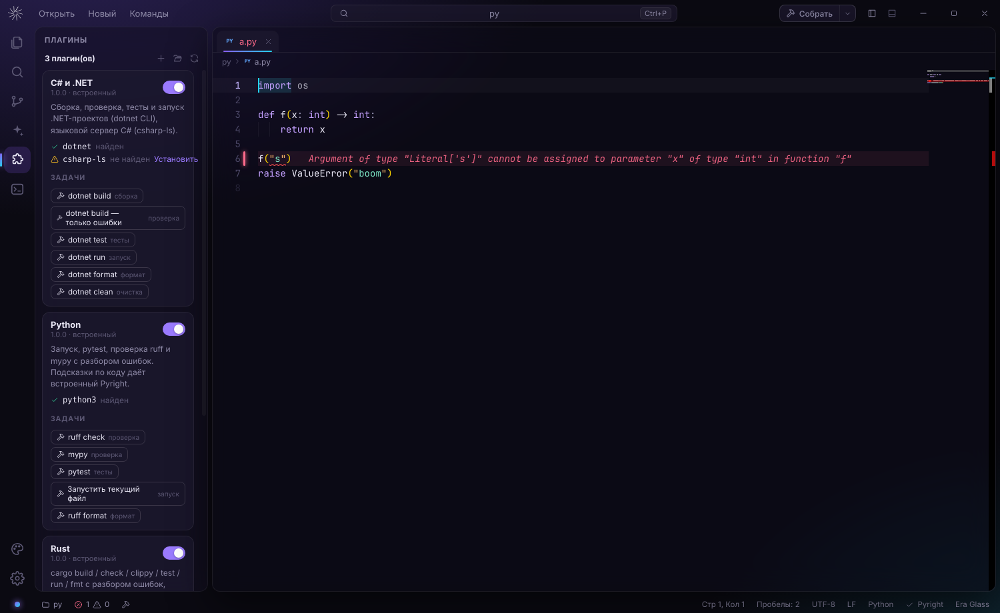
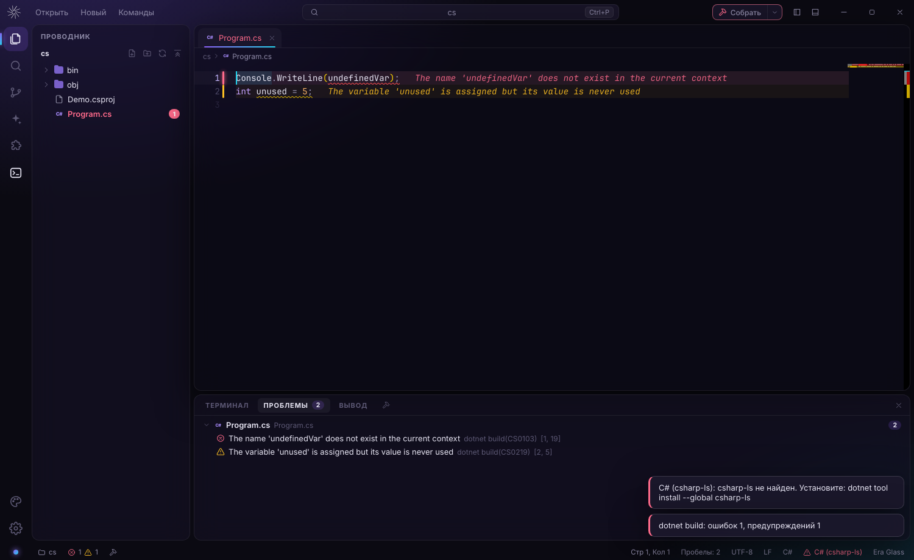
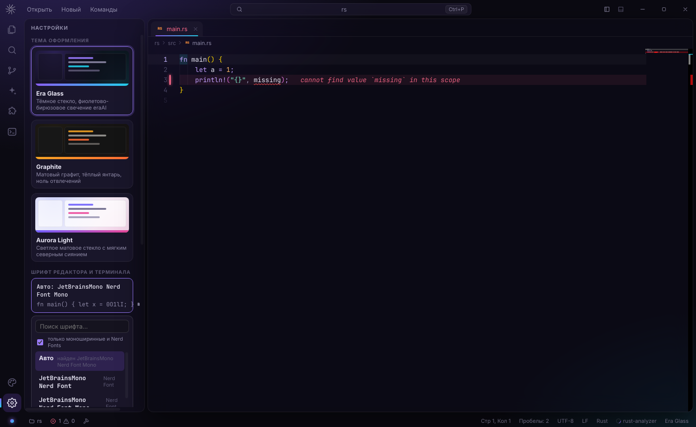
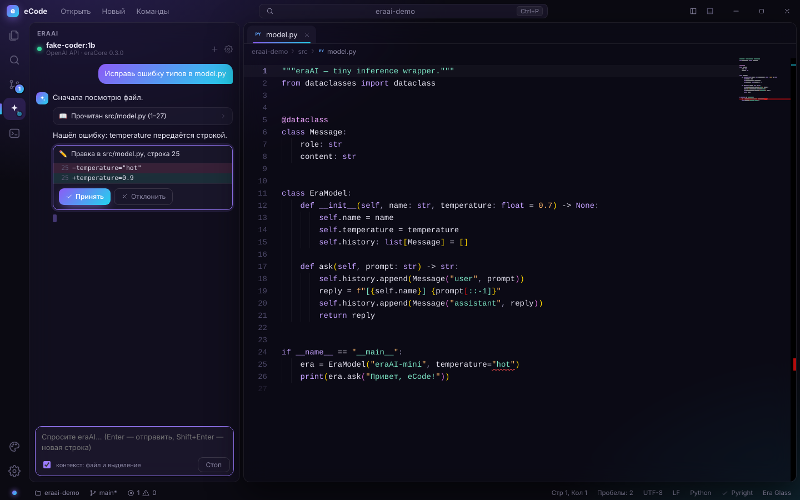

# eCode

**For humans and comfort.** Быстрый и красивый редактор кода в стиле eraAI: Electron + React + Monaco (то же ядро редактора, что и в VS Code).


## Возможности

- **Редактор Monaco**: подсветка 80+ языков, мультикурсоры, sticky scroll, мини-карта, цветные пары скобок.
- **Языковые серверы (LSP)** для **Python** (Pyright) и **TypeScript/JavaScript** (typescript-language-server). Работают без установки: серверы идут в комплекте и запускаются на встроенном Node из Electron.
  - Автодополнение с документацией, подсказки при наведении, сигнатуры функций.
  - Переход к определению (F12), в том числе в другой файл.
  - Переименование символа во всём проекте (F2): затронутые файлы открываются во вкладках, их остаётся сохранить.
  - Форматирование, структура файла (Ctrl/⌘+Shift+O).
  - Ошибки и предупреждения прямо в коде и на панели **«Проблемы»** (Ctrl/⌘+Shift+M), счётчики в статус-баре.
- **Git** (Ctrl+Shift+G):
  - изменения и индекс, индексация и откат отдельных файлов или всех сразу;
  - коммит по Ctrl+Enter, push, pull, fetch, синхронизация ↑↓;
  - смена и создание веток, инициализация репозитория;
  - **вкладки с диффами** (рядом или в одну колонку);
  - цвета статусов (M/U/A/D) в проводнике, счётчик изменений на иконке.
- **Настоящий терминал**: xterm.js + node-pty, 256 цветов, `vim`, `htop`, интерактивные программы. Несколько вкладок (Ctrl+Shift+\`), ссылки кликабельны, копирование и вставка по Ctrl+Shift+C/V. Пока фокус в терминале, сочетания вроде Ctrl+R, Ctrl+W, Ctrl+B уходят в оболочку, а палитра и быстрое открытие работают как обычно. Если node-pty не загрузится, включается упрощённый режим.
- **Запуск файла** (Ctrl+F5): Python, Node, TS (через tsx), shell, Ruby, Go — в терминале.
- **Проводник**: виртуализированное дерево, создание файлов и папок прямо в дереве (`src/utils/new.ts` создаст промежуточные папки), F2, корзина, контекстное меню, клавиатура.
- **Вкладки**: перетаскивание, закрытие средней кнопкой, индикатор несохранённых изменений.
- **Быстрое открытие (Ctrl/⌘+P)** с нечётким поиском, **палитра команд (Ctrl/⌘+Shift+P)**, переход к строке (`:42`).
- **Поиск по проекту (Ctrl/⌘+Shift+F)**: регистр, слово целиком, регулярные выражения, фильтр файлов.
- Слежение за файлами на диске, восстановление сессии, drag & drop, своя строка заголовка.
- **Живой интерфейс**: плавная смена темы (View Transitions), скользящий индикатор на панели слева, появление вкладок, строк дерева и панелей, «пульс» счётчиков ошибок, логотип крутится во время сборки или ответа eraAI. Всё отключается одним переключателем в настройках.

## Плагины, сборка и проверка ошибок



Плагин — папка с файлом `plugin.json`: задачи (сборка, проверка, тесты, запуск, формат), разбор вывода компилятора в ошибки, языковой сервер и инструменты, которые нужны плагину. Кода писать не надо. Встроенные плагины лежат в `resources/plugins`, свои — в `~/.ecode/plugins` (кнопка «+» на панели плагинов создаёт шаблон). Панель плагинов: Ctrl/⌘+Shift+X.

| Плагин | Задачи | Языковой сервер |
| --- | --- | --- |
| **C# и .NET** | `dotnet build`, проверка, `test`, `run`, `format`, `clean` (находит `.sln` / `.csproj` / `.fsproj`) | csharp-ls (`dotnet tool install --global csharp-ls`) |
| **Rust** | `cargo build`, `check`, `clippy`, `test`, `run`, `fmt` (находит `Cargo.toml`) | rust-analyzer (`rustup component add rust-analyzer`) |
| **Python** | `ruff check`, `mypy`, `pytest`, запуск файла, `ruff format` | встроенный Pyright |

Пример своего плагина (`~/.ecode/plugins/go/plugin.json`):

```json
{
  "id": "my.go",
  "name": "Go",
  "version": "1.0.0",
  "requires": [{ "command": "go", "install": "https://go.dev/dl/" }],
  "languageServers": [{ "id": "go", "name": "gopls", "languages": ["go"], "command": "gopls", "install": "go install golang.org/x/tools/gopls@latest" }],
  "tasks": [
    {
      "id": "go.build",
      "label": "go build",
      "group": "build",
      "command": "go build ./...",
      "cwd": "${findDir:**/go.mod}",
      "problemMatcher": { "regexp": "^(?<file>[^:\\s]+\\.go):(?<line>\\d+):(?<column>\\d+): (?<message>.+)$", "severity": "error" },
      "when": { "files": ["**/go.mod"] }
    }
  ],
  "runners": [{ "extensions": [".go"], "command": "go run \"${file}\"" }]
}
```

Переменные: `${workspaceFolder}`, `${file}`, `${fileDirname}`, `${fileBasename}`, `${fileBasenameNoExtension}`, `${pluginDir}`, `${python}`, `${find:шаблон|шаблон}` (ближайший к корню файл), `${findDir:…}` (его папка). Готовые разборщики: `msbuild`, `rustc`, `gcc`, `tsc`, `python`; свой задаётся объектом `{ "regexp": "(?<file>…):(?<line>\\d+): (?<message>.*)" }` с именованными группами `file`, `line`, `column`, `severity`, `code`, `message`.

- **Кнопка «Собрать»** в заголовке окна и **F5**: повторяют последнюю задачу сборки этого проекта без вопросов (в первый раз спросят, если сборок несколько, например `dotnet build` и `cargo build`). Во время сборки кнопка превращается в «Стоп» (**Shift+F5**), после — вспыхивает зелёным или красным. Стрелка рядом открывает все задачи проекта.
- **Ctrl/⌘+Shift+B** всегда даёт выбрать задачу сборки. Остальные задачи есть в палитре («Задачи: …») и на панели плагинов.
- Вывод идёт во вкладку **«Вывод»**, строки с ошибками кликабельны. Ошибки MSBuild, rustc, gcc/clang, tsc, ruff, mypy, pytest и трейсбеки Python превращаются в диагностику.
- Если инструмент не найден, плагин показывает «не найден» с кнопкой «Установить». Отсутствующий языковой сервер подскажет команду установки.
- На macOS приложение, запущенное из Finder, подхватывает `PATH` из вашей оболочки (Homebrew, `~/.cargo/bin`, `~/.dotnet/tools`), так что `cargo`, `dotnet` и `node` находятся без настройки.

### Подсветка ошибок



Ошибки языковых серверов и сборки видны сразу везде: волнистое подчёркивание, текст ошибки в конце строки (**Error Lens**), полоса на полях, красные и жёлтые имена файлов во вкладках и проводнике (со счётчиком, папки тоже подсвечиваются), панель «Проблемы» и счётчики в статус-баре. Одна и та же ошибка от компилятора и от языкового сервера показывается один раз. Error Lens отключается в настройках.

### Шрифт



По умолчанию eCode ищет установленный **Nerd Font** (JetBrainsMono, FiraCode, CaskaydiaCove, Hack, Meslo, Iosevka и другие, предпочитая Mono-варианты), чтобы в терминале правильно отображались значки и темы приглашения. В настройках можно выбрать любой шрифт системы с предпросмотром, фильтр «только моноширинные и Nerd Fonts» включён по умолчанию. Шрифт общий для редактора и терминала.

## eraAI на eraCore



Панель **eraAI** (Ctrl/⌘+Shift+A) разворачивает вашу локальную модель через пакет [eraCore](https://github.com/ph1ncyn/eraCore) и даёт ей работать с проектом.

- **Источники модели**: Ollama, любой OpenAI-совместимый сервер (LM Studio, vLLM, llama.cpp server…), локальный файл **GGUF** через llama-cpp-python, mock для проверки. Список моделей Ollama подтягивается сам.
- **Что умеет агент**: `list_files`, `read_file` (с номерами строк), `search`, `replace_lines`, `insert_lines`, `replace_text`, `write_file`.
- **Безопасность**:
  - каждая правка показывается мини-диффом с кнопками «Принять / Отклонить» (автоприменение включается в настройках);
  - правки идут через редактор, поэтому их видно во вкладках и можно отменить по Ctrl+Z;
  - доступ за пределы открытой папки запрещён.
- **Контекст**: модель видит открытый файл, позицию курсора и выделение. В контекстном меню редактора есть «eraAI: объяснить / исправить / документировать».
- **Установка**: eCode ищет `python3` / `python` / `py`. Если eraCore не установлен, панель предложит `pip install eracore` прямо в терминале. Путь к Python можно указать вручную.

Как это устроено: `resources/era/bridge.py` запускается выбранным Python, загружает модель через `eraCore.LLM` и ведёт цикл агента. Модель вызывает инструменты блоками `<tool>{json}</tool>`, eCode выполняет их и возвращает результат. Обмен — JSON-строки через stdin/stdout.

## Три варианта оформления

Переключаются на лету через палитру («Сменить тему»), статус-бар или настройки.

| Era Glass | Graphite | Aurora Light |
| --- | --- | --- |
|  |  |  |
| Тёмное стекло, фиолетово-бирюзовое свечение. Фирменный стиль eraAI. | Матовый графит без размытия, янтарные акценты. Самый быстрый на слабом железе. | Светлое матовое стекло с мягким сиянием. Для дневной работы. |

Тема описывается одним объектом в `src/renderer/src/themes.ts` (CSS-переменные интерфейса и цвета Monaco), поэтому новая добавляется за несколько минут.

## План развития

1. **eraAI**: ✅ панель с локальной моделью на eraCore, чтением и правкой файлов. Дальше: подсказки ИИ прямо при наборе (inline completion), запуск команд в терминале с подтверждением, нативный tool calling для моделей, которые его поддерживают.
2. **Доработка IDE**: ✅ плагины, сборка и проверка C#/.NET, Rust, Python, Error Lens, выбор шрифта. Дальше: поиск всех ссылок (Shift+F12), быстрые исправления (лампочка), отладчик (DAP), отметки изменений git на полях редактора, плагины для Go и C++.
3. **Облегчение Electron-версии** (часы работы): загрузка языков Monaco по требованию, сжатие установщика.
4. **Порт на Tauri (Rust)**: ✅ сделан, работает параллельно с Electron (см. «Две сборки»). Дальше: проверить на Windows и macOS, собирать установщики в CI для трёх ОС, решить, класть ли Node в пакет ради языковых серверов.
   - Итог на Linux: `.deb` весит 14 МБ вместо ~100 МБ+, но памяти уходит больше (WebKitGTK тяжелее Chromium с Monaco). Прогноз «на 100–200 МБ меньше памяти» на Linux не подтвердился.
   - Языковым серверам нужен системный Node.js: в пакет он пока не входит.

## Две сборки: Electron и Tauri

Интерфейс (React + Monaco) общий. Бэкенд реализован дважды: `src/main/` для Electron (Node) и `src-tauri/` для Tauri (Rust). Это два варианта одного API `window.ecode` (`src/shared/types.ts`). Под Tauri его подставляет `src/renderer/src/platform/tauri.ts`.

| | Electron | Tauri |
| --- | --- | --- |
| Пакет для Linux | ~100 МБ+ (Electron занимает 257 МБ в распакованном виде) | **14 МБ** `.deb` (50 МБ распакованный, вместе с языковыми серверами) |
| Память интерфейса (Linux, PSS) | ≈ 335 МБ | ≈ 550 МБ (WebKitGTK) |
| Языковые серверы | встроенный Node из Electron | нужен установленный **Node.js** (или `ECODE_NODE`) |
| Движок | Chromium везде | WebView2 (Windows), WKWebView (macOS), WebKitGTK (Linux) |
| Терминал | node-pty (нативный модуль) | portable-pty (чистый Rust, ConPTY на Windows) |

Замеры сделаны на Linux под Xvfb, проект открыт, работают Pyright и TS-сервер. На Linux Tauri выигрывает в размере, но не в памяти. На macOS и Windows цифры нужно перепроверить.

Tauri-версия на Linux проверена автотестом через `tauri-driver`, в том числе установленный `.deb`: проводник, вкладки, Pyright, быстрое открытие, поиск, терминал (PTY), контекстное меню, eraAI с правкой файла, git-дифф. Сборки под Windows и macOS не проверялись.

```bash
# Tauri: нужен Rust (rustup) и системные зависимости
# Linux: sudo apt install libwebkit2gtk-4.1-dev libgtk-3-dev libsoup-3.0-dev librsvg2-dev libssl-dev
pnpm tauri:dev      # режим разработки
pnpm tauri:build    # установщики в src-tauri/target/release/bundle/
```

## Сборка в GitHub Actions

`.github/workflows/build.yml` запускается на каждый push в `main` и `claude/**`, на pull request и вручную (Run workflow).

| Job | Что делает |
| --- | --- |
| **check** | проверка типов, сборка интерфейса для обеих версий, `cargo fmt --check`, `clippy -D warnings` |
| **Tauri** · Linux / Windows / macOS | `.deb`, `.rpm`, `.AppImage` · `.msi`, `.exe` (NSIS) · universal `.dmg` (Intel + Apple Silicon) |
| **Electron** · Linux / Windows / macOS | `.AppImage`, `.deb` · `.exe` (NSIS) · `.dmg`, `.zip` |
| **release** | только для тегов `v*`: прикладывает все установщики к черновику релиза |

Установщики лежат на странице прогона, в разделе **Artifacts**. Чтобы выпустить версию, поставьте тег: `git tag v0.1.0 && git push origin v0.1.0`. Появится черновик релиза со всеми файлами, его останется опубликовать.

Сборки **не подписаны**: macOS при первом запуске попросит открыть приложение через контекстное меню («Открыть»), Windows SmartScreen покажет предупреждение. Для подписи понадобятся сертификаты Apple Developer и Windows code signing.

## Запуск

```bash
pnpm install
pnpm dev            # режим разработки с HMR
pnpm build          # production-сборка в out/
pnpm start          # запуск собранной версии
pnpm typecheck
pnpm package:win    # или package:mac / package:linux, установщики появятся в dist/
```

## Горячие клавиши

| Действие | Клавиши |
| --- | --- |
| Перейти к файлу | Ctrl/⌘+P |
| Палитра команд | Ctrl/⌘+Shift+P, F1 |
| Перейти к строке | Ctrl+G |
| Поиск по файлам | Ctrl/⌘+Shift+F |
| Проводник | Ctrl/⌘+Shift+E |
| Git | Ctrl+Shift+G |
| Панель (терминал) | Ctrl/⌘+J, Ctrl+` |
| Новый терминал | Ctrl+Shift+` |
| Проблемы | Ctrl/⌘+Shift+M |
| Запустить файл | Ctrl+F5 |
| Собрать (последняя сборка) / остановить | F5 / Shift+F5 |
| Выбрать задачу сборки | Ctrl/⌘+Shift+B |
| Плагины | Ctrl/⌘+Shift+X |
| Перейти к определению / переименовать | F12 / F2 |
| Коммит (в поле сообщения) | Ctrl/⌘+Enter |
| Боковая панель | Ctrl/⌘+B |
| Сохранить / как… / все | Ctrl/⌘+S / +Shift+S / +Alt+S |
| Новый файл / открыть папку | Ctrl/⌘+N / Ctrl/⌘+O |
| Недавние папки | Ctrl/⌘+R |
| Закрыть вкладку | Ctrl/⌘+W |
| Следующая/предыдущая вкладка | Ctrl+Tab / Ctrl+Shift+Tab |
| Символы в файле | Ctrl/⌘+Shift+O |
| Масштаб шрифта | Ctrl/⌘+= / − / 0 |
| Настройки | Ctrl/⌘+, |

## Архитектура

```
src/
  main/           процесс Electron
    index.ts        окно, диалоги, меню
    fs.ts           файловая система, поиск, watcher
    terminal.ts     node-pty (или упрощённая оболочка)
    lsp.ts          запуск языковых серверов, JSON-RPC по stdio
    git.ts          git CLI: статус, индекс, коммит, ветки, push/pull
    era.ts          запуск моста eraCore (resources/era/bridge.py), поиск Python
    tasks.ts        фоновые задачи плагинов, поиск программ в PATH, список плагинов
    shellEnv.ts     PATH из оболочки пользователя для запуска из Finder
    settings.ts     настройки
  preload/        безопасный мост window.ecode (contextIsolation + sandbox)
  shared/         общие типы и API
  renderer/src/
    actions.ts        логика (открытие, сохранение, вкладки, файловые операции)
    editorService.ts  модели Monaco, редактор диффов, dirty-трекинг
    lspClient.ts      LSP ↔ Monaco: провайдеры, синхронизация документов, диагностика
    scm.ts            git-действия и диффы
    eraService.ts     eraAI: развёртывание модели, чат, подтверждение правок
    aiTools.ts        инструменты агента (чтение, поиск, правка файлов)
    terminalService.ts сессии xterm.js
    pluginService.ts  загрузка плагинов, проверка инструментов, шаблон нового плагина
    taskService.ts    запуск задач, переменные ${file}/${find:…}, ошибки сборки → диагностика
    fontService.ts    поиск Nerd Font, список шрифтов
    lib/problemMatchers.ts разбор вывода MSBuild, rustc, gcc, tsc, ruff, mypy, pytest
    commands.ts       реестр команд и горячих клавиш
    themes.ts         варианты оформления (UI, Monaco, терминал)
    components/       TitleBar, ActivityBar, Explorer, Search, Scm, Plugins, Settings, FontPicker, EditorArea, Panel, Palette
```

Тяжёлая работа (обход файлов, поиск, git, языковые серверы, PTY) выполняется в main-процессе, интерфейс получает готовые результаты по IPC.

Чтобы проверить упрощённый режим терминала, запустите приложение с `ECODE_NO_PTY=1`.
